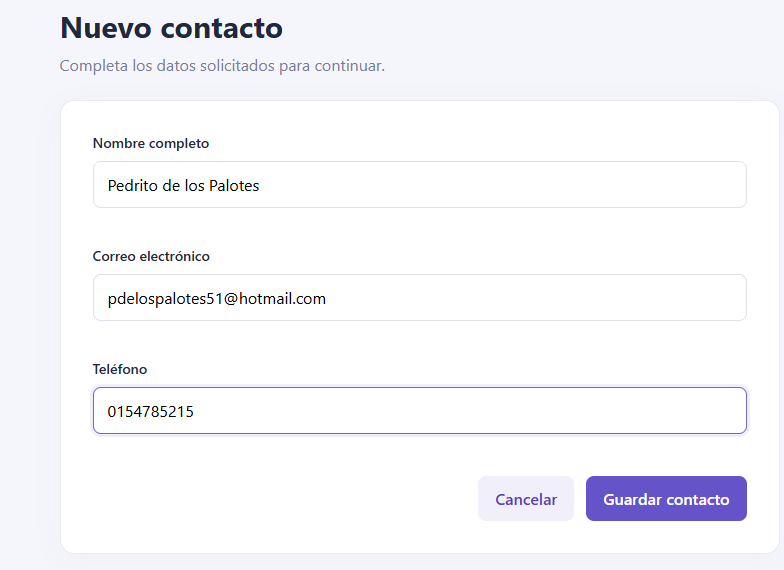
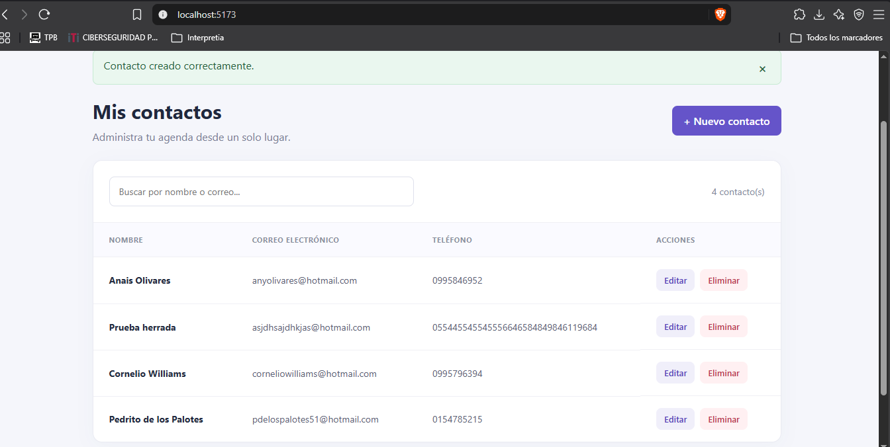
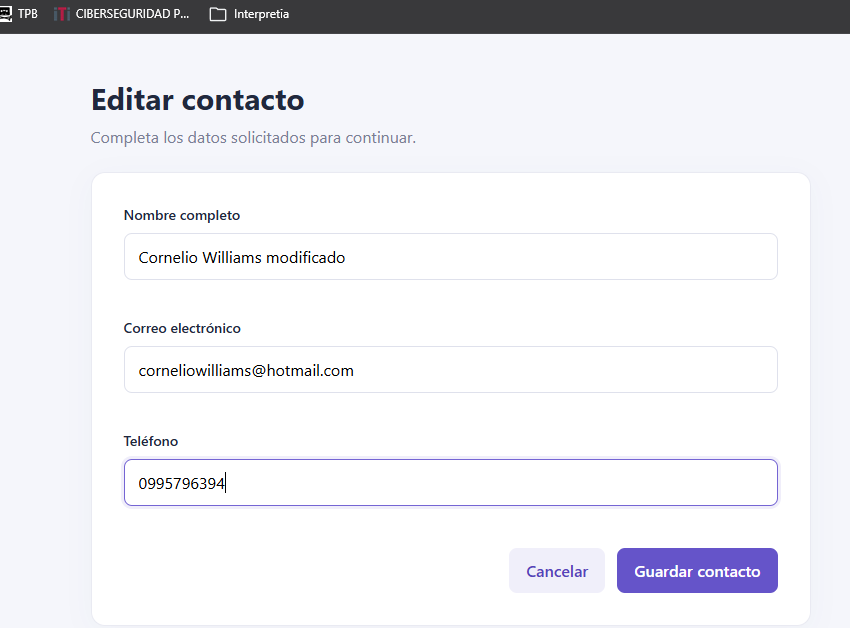
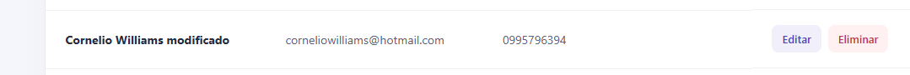
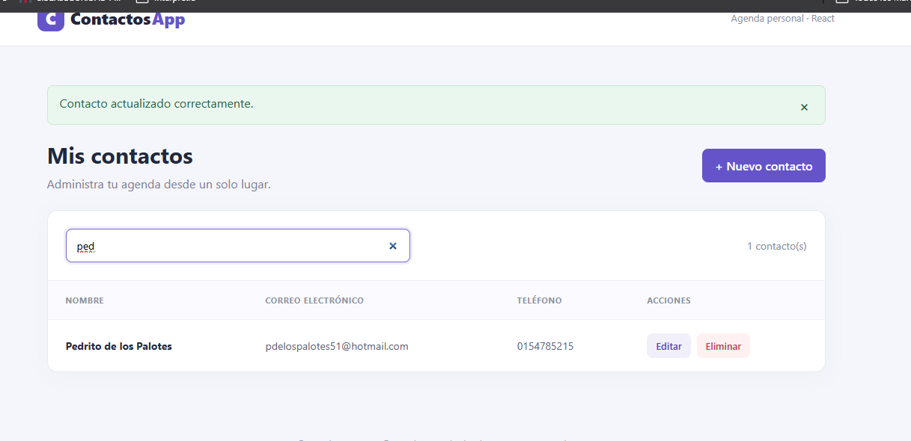

# Gestor de contactos — React SPA

Aplicación de una sola página para administrar contactos (nombre, correo y teléfono), sin backend. Proyecto desarrollado con React, Vite y React Router.

## Requisitos

- Node.js 18 o superior (recomendado: Node.js 20).
- npm.

## Instalación y ejecución

```bash
npm install
npm run dev
```

Abre la URL local indicada por Vite (`http://localhost:5173`).

## Compilación para producción

```bash
npm run build
npm run preview
```

Los archivos compilados quedan en `dist/`. No se utiliza Tailwind ni Bootstrap; los estilos son CSS propio, sin pasos de build adicionales.

## Decisiones técnicas

- `useLocalStorage` es un custom hook que inicializa los contactos desde la clave `contacts` y persiste los cambios mediante `useEffect`.
- El formulario `ContactForm` es controlado con `useState`, reutilizable para crear y editar, y valida nombre (mínimo 2), correo (formato) y teléfono (solo dígitos, mínimo 7).
- React Router separa las vistas `/`, `/nuevo` y `/editar/:id`, sin necesidad de un servidor de API.
- Cada contacto recibe un identificador mediante `crypto.randomUUID()`. Se solicita confirmación antes de eliminar y se muestra feedback visual de las operaciones.

## Evidencias de funcionamiento

1. `evidencias/crear.png` — formulario completo y contacto agregado.


2. `evidencias/editar.png` — modificación de un contacto existente.


3. `evidencias/buscar.png` — búsqueda por nombre o correo.


## Estructura

```text
src/
  components/ContactForm.jsx
  hooks/useLocalStorage.js
  pages/ContactList.jsx
  pages/ContactEditor.jsx
  App.jsx
  main.jsx
  styles.css
```

## Checklist de pruebas manuales

1. Crear un contacto válido y comprobar que aparece en el listado.
2. Recargar la página y comprobar que el contacto persiste.
3. Editarlo, guardar y comprobar los cambios.
4. Buscar por nombre y correo.
5. Probar campos inválidos y verificar que Guardar está deshabilitado.
6. Eliminar un contacto y verificar que aparece el diálogo de confirmación.
7. Comprobar las rutas `/`, `/nuevo` y `/editar/:id`.

**Nota:** los contactos se guardan únicamente en el navegador actual; borrar los datos del sitio también los elimina.
